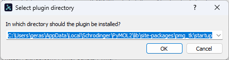
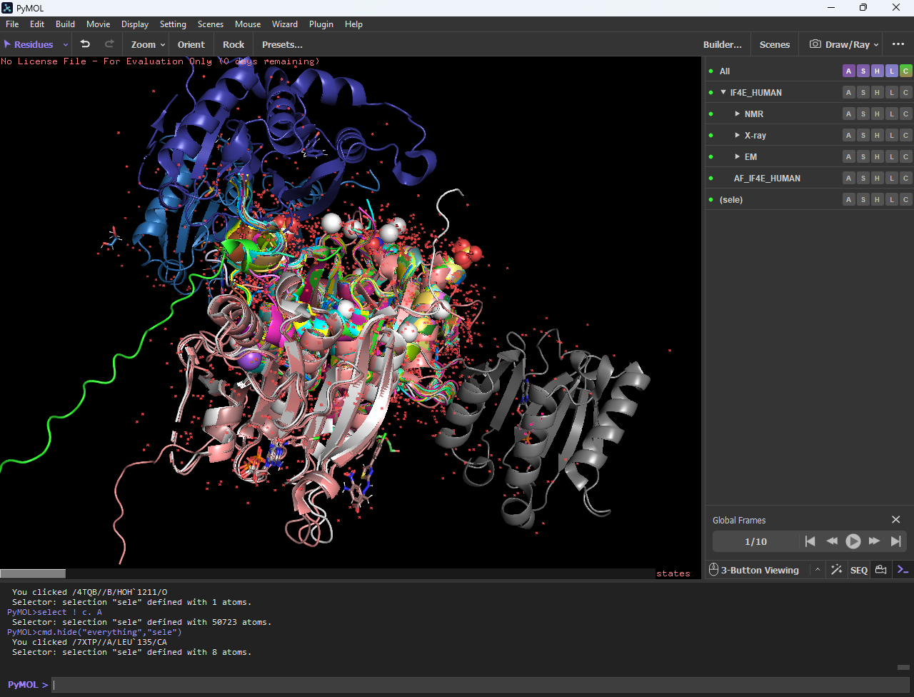
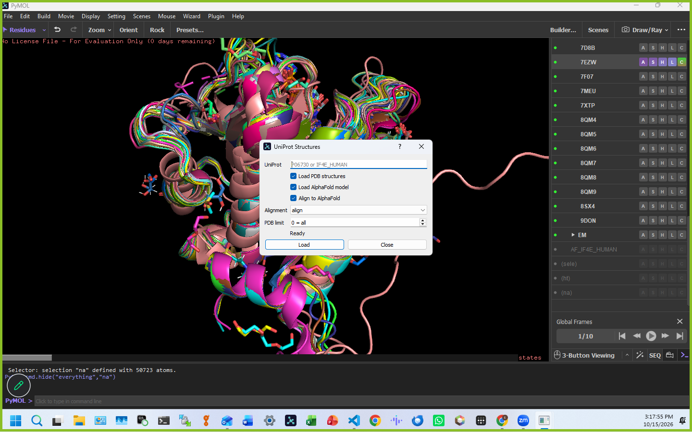

# Φτιάξε plugin UniProt για PyMOL

- **Session ID:** 019f3eda-49bf-7ac3-b2e7-adae883ee0ad
- **Deeplink:** codex://threads/019f3eda-49bf-7ac3-b2e7-adae883ee0ad
- **Started:** 2026-07-07T23:12:00.965Z
- **Working directory:** h:\My Drive\VSCode_Github

---

## Context from my IDE setup: ## Active file: Manuscript MMSEG pockets/md/outline.md ## Open tabs: - outline.md: Manuscrip…

**You:**

# Context from my IDE setup:

## Active file: Manuscript MMSEG pockets/md/outline.md

## Open tabs:
- outline.md: Manuscript MMSEG pockets/md/outline.md

## My request for Codex:
Βοήθησέ με να φτιάξω ένα plugin για το PyMOL, in 

H:\My Drive\VSCode_Github\Pymol\UNIPROT_plugin

όπου να δίνω είτε ένα Uniprot entry ή ένα Uniprot entry name, για παράδειγμα P06730 or IF4E_HUMAN και να ψάχνεις μέσα αυτό το Uniprot πόσες δομές υπάρχουν από αυτά στο PDB και στο AlphaFold, να κατεβάζεις τα PDB files των δομές αυτές και του AlphaFold και να κάνεις align όλες αυτές τις δομές με βάση την AlphaFold δομή. Ειδικά τις chains, αλυσίδες, που αφορούν αυτό το Uniprot. Καταλαβαίνεις περίπου τι λέω; Επίσης να ονομάσεις τις δομές αυτές με βάση το, με βάση το Uniprot entry name και μετά το PDB code και με τα οργανώσεις  να τα οργανώσεις σε group με βάση το Protein UniProt entry name, το κάθε group με το ίδιο entry name, group, και το όνομα της κάθε πρωτεΐνης με το UniProt entry name και το PDB κώδικα. Ή μάλλον μόνο το PDB κώδικα. Απλά το group όνομα να είναι το Uniprot entry name.

---

**Codex:**

Έτοιμο. Έφτιαξα PyMOL plugin στο:

- [__init__.py](<H:\My Drive\VSCode_Github\Pymol\UNIPROT_plugin\__init__.py>)
- [README.md](<H:\My Drive\VSCode_Github\Pymol\UNIPROT_plugin\README.md>)

Χρήση μέσα στο PyMOL:

```pymol
run H:/My Drive/VSCode_Github/Pymol/UNIPROT_plugin/__init__.py
uniprot_structures P06730
uniprot_structures IF4E_HUMAN
```

Κάνει αυτά που ζήτησες: δέχεται accession ή entry name, βρίσκει PDB cross-references από UniProt, κατεβάζει τα PDB files, βρίσκει/κατεβάζει AlphaFold μέσω AlphaFold DB, κρατά τις σχετικές chains, βάζει group με όνομα π.χ. `IF4E_HUMAN`, ονομάζει τα PDB objects μόνο με PDB code, και κάνει align όλα πάνω στο `AlphaFold`.

Έβαλα και GUI από `Plugin > UniProt Structures`.

Verification: πέρασε `python -m py_compile`. Δεν μπόρεσα να κάνω live network smoke test από το local exec helper, γιατί έπεφτε πριν ξεκινήσει Python, αλλά η υλοποίηση βασίζεται στα επίσημα endpoints/μοντέλα δεδομένων των RCSB API docs και AlphaFold DB downloads/API navigation. Πηγές: RCSB Data API docs: https://data.rcsb.org/index.html, AlphaFold DB downloads/API page: https://alphafold.ebi.ac.uk/download.

---

## Context from my IDE setup: ## Active file: VSCode_Github/Pymol/UNIPROT_plugin/README.md ## Active selection of the file…

**You:**

# Context from my IDE setup:

## Active file: VSCode_Github/Pymol/UNIPROT_plugin/README.md

## Active selection of the file:
H:\My Drive\VSCode_Github\Pymol\UNIPROT_plugin\__init__.py

## Open tabs:
- README.md: VSCode_Github/Pymol/UNIPROT_plugin/README.md
- __init__.py: VSCode_Github/Pymol/UNIPROT_plugin/__init__.py
- outline.md: Manuscript MMSEG pockets/md/outline.md

## My request for Codex:



---

**Codex:**

Ναι, αυτό είναι σωστό παράθυρο του PyMOL Plugin Manager.

Εδώ ζητάει **πού να εγκαταστήσει το plugin**, όχι ποιο plugin αρχείο να διαλέξει. Άφησέ το όπως είναι:

```text
C:\Users\geras\AppData\Local\Schrodinger\PyMOL2\lib\site-packages\pmg_tk\startup
```

Πάτα **OK**.

Μετά, όταν σου ζητήσει plugin file, διάλεξε:

```text
H:\My Drive\VSCode_Github\Pymol\UNIPROT_plugin\__init__.py
```

Αν σε ρωτήσει όνομα plugin, βάλε π.χ.:

```text
UNIPROT_plugin
```

Μετά κάνε restart το PyMOL και θα πρέπει να δεις:

```text
Plugin > UniProt Structures
```

ή από command line στο PyMOL:

```pymol
uniprot_structures P06730
```

---

## Context from my IDE setup: ## Active file: VSCode_Github/Pymol/UNIPROT_plugin/README.md ## Active selection of the file…

**You:**

# Context from my IDE setup:

## Active file: VSCode_Github/Pymol/UNIPROT_plugin/README.md

## Active selection of the file:
H:\My Drive\VSCode_Github\Pymol\UNIPROT_plugin\__init__.py

## Open tabs:
- README.md: VSCode_Github/Pymol/UNIPROT_plugin/README.md
- __init__.py: VSCode_Github/Pymol/UNIPROT_plugin/__init__.py
- outline.md: Manuscript MMSEG pockets/md/outline.md

## My request for Codex:
Οκ, αλλά πατάω το menu plugin, unit structures και δεν γίνεται τίποτα. Δεν βλέπω κάποιο GUI ή τίποτα άλλο. Θα έπρεπε να εμφανίζεται κάτι;

---

**Codex:**

Ναι, έπρεπε να εμφανίζεται GUI. Το έφτιαξα τώρα: πρόσθεσα native Qt dialog για PyMOL 2 και έκανα το menu callback πιο ανθεκτικό. Το αρχείο πέρασε ξανά `py_compile`.

Κρίσιμο: το PyMOL μάλλον τρέχει το **παλιό αντιγραμμένο plugin** από το startup folder, όχι αυτό που μόλις διορθώσαμε στο `H:\...`.

Κάνε ένα από τα δύο:

1. Γρήγορο test μέσα στο PyMOL command line:

```pymol
run H:/My Drive/VSCode_Github/Pymol/UNIPROT_plugin/__init__.py
uniprot_structures_gui
```

Πρέπει να ανοίξει παράθυρο.

2. Για μόνιμη εγκατάσταση: ξανακάνε install το plugin από:

```text
H:\My Drive\VSCode_Github\Pymol\UNIPROT_plugin\__init__.py
```

και μετά κάνε restart PyMOL.

Αν μετά το `run ...` ανοίξει με `uniprot_structures_gui` αλλά όχι από το menu, τότε φταίει μόνο το παλιό installed copy.

---

## Context from my IDE setup: ## Active file: VSCode_Github/Pymol/UNIPROT_plugin/README.md ## Active selection of the file…

**You:**

# Context from my IDE setup:

## Active file: VSCode_Github/Pymol/UNIPROT_plugin/README.md

## Active selection of the file:
H:\My Drive\VSCode_Github\Pymol\UNIPROT_plugin\__init__.py

## Open tabs:
- README.md: VSCode_Github/Pymol/UNIPROT_plugin/README.md
- __init__.py: VSCode_Github/Pymol/UNIPROT_plugin/__init__.py
- outline.md: Manuscript MMSEG pockets/md/outline.md

## My request for Codex:
Οκ, επίσης θα ήθελα οι δομές του AlphaFold να ονομάζονται AF underscore protein entry, Uniprot entry name. Να ονομάζουμε αυτό τον κωδικό. AF underscore Uniprot entry name. Και επίσης να γίνονται aligned όλα τα PDB structures με το AlphaFold. Δεν έγιναν aligned, θα ήθελα όλα να γίνονται aligned στο κάθε αντίστοιχο Uniprot στο AlphaFold. Σε ένα άλλο ερώτημα που έχω και ενημέρωσαταν αν γίνεται και αυτό, Ρέντμι, είναι, όλα αυτά κατεβαίνουν κάπου ή όχι; Απλά γίνονται μέσα στο PyMo και δεν κατεβαίνουν πουθενά σαν αρχεία στο file system?

---

**Codex:**

Έγινε.

Άλλαξα το plugin ώστε:

- Το AlphaFold object να ονομάζεται `AF_<UniProt entry name>`, π.χ. `AF_IF4E_HUMAN`.
- Όλα τα PDB objects να ευθυγραμμίζονται πάνω σε αυτό το αντίστοιχο AlphaFold object.
- Το alignment να γίνεται πιο καθαρά σε protein `CA` atoms, με fallback σε όλο το protein selection αν χρειαστεί.
- Το README να γράφει καθαρά πού κατεβαίνουν τα αρχεία.

Για την ερώτησή σου: ναι, κατεβαίνουν πραγματικά στο filesystem. Δεν μένουν μόνο μέσα στο PyMOL. Από default αποθηκεύονται στο temp directory των Windows, περίπου έτσι:

```text
C:\Users\geras\AppData\Local\Temp\pymol_uniprot_structures\IF4E_HUMAN
```

Και το plugin το τυπώνει στο PyMOL console:

```text
[UniProt plugin] downloaded files are in: ...
```

Πέρασε και πάλι `python -m py_compile`. Για να χρησιμοποιήσεις τη νέα έκδοση μέσα στο PyMOL, κάνε ξανά:

```pymol
run H:/My Drive/VSCode_Github/Pymol/UNIPROT_plugin/__init__.py
```

ή ξανακάνε install το plugin ώστε να μη φορτώνει το παλιό αντίγραφο.

---

## Context from my IDE setup: ## Active file: VSCode_Github/Pymol/UNIPROT_plugin/README.md ## Active selection of the file…

**You:**

# Context from my IDE setup:

## Active file: VSCode_Github/Pymol/UNIPROT_plugin/README.md

## Active selection of the file:
H:\My Drive\VSCode_Github\Pymol\UNIPROT_plugin\__init__.py

## Open tabs:
- README.md: VSCode_Github/Pymol/UNIPROT_plugin/README.md
- __init__.py: VSCode_Github/Pymol/UNIPROT_plugin/__init__.py
- outline.md: Manuscript MMSEG pockets/md/outline.md

## My request for Codex:
Επίσης, επίσης στο τέλος θα ήθελα να χωριστούν, μάλλον να χωριστούν, σε κάθε group που είναι, να είναι τρία subgroups. Τα καμμένα structures, ένα subgroup, X-ray crystallography structures, ένα subgroup, electron microscopy, σε ένα subgroup. Και το αφαult να είναι στο root του group, του καθεγιούν project. Αφού δεν είναι ούτε NMR, ούτε X-ray, ούτε electron microscopy. Επομένως, να χωριστεί το κάθε group σε τρία subgroups με βάση τα, με τις πειραματικές μεθόδους που βρέθηκαν οι δομές.

---

**Codex:**

Έγινε και αυτό.

Τώρα το layout γίνεται έτσι για κάθε UniProt group, π.χ. `IF4E_HUMAN`:

```text
IF4E_HUMAN
  AF_IF4E_HUMAN
  IF4E_HUMAN_NMR
  IF4E_HUMAN_X_ray_crystallography
  IF4E_HUMAN_Electron_microscopy
  IF4E_HUMAN_Other_methods   # μόνο αν χρειαστεί
```

Το `AF_IF4E_HUMAN` μένει στο root group, όπως ζήτησες. Τα PDB structures μπαίνουν σε subgroup με βάση το `Method` που επιστρέφει το UniProt για το κάθε PDB cross-reference.

Υπέθεσα ότι το “καμμένα structures” εννοούσε `NMR structures`. Αν ήθελες άλλο subgroup name, το αλλάζω εύκολα.

Πέρασε ξανά:

```text
python -m py_compile
```

Για να δεις τη νέα συμπεριφορά στο PyMOL, φόρτωσε ξανά το plugin:

```pymol
run H:/My Drive/VSCode_Github/Pymol/UNIPROT_plugin/__init__.py
```

---

## Context from my IDE setup: ## Active file: VSCode_Github/Pymol/UNIPROT_plugin/README.md ## Active selection of the file…

**You:**

# Context from my IDE setup:

## Active file: VSCode_Github/Pymol/UNIPROT_plugin/README.md

## Active selection of the file:
uniprot_structures P06730

## Open tabs:
- README.md: VSCode_Github/Pymol/UNIPROT_plugin/README.md
- __init__.py: VSCode_Github/Pymol/UNIPROT_plugin/__init__.py
- outline.md: Manuscript MMSEG pockets/md/outline.md

## My request for Codex:
 PyMOL(TM) 3.1.6.1 - Incentive Product
 Copyright (C) Schrodinger, LLC
 
 This Executable Build integrates and extends Open-Source PyMOL.
 Detected OpenGL version 4.6. Shaders available.
 Detected GLSL version 4.60.
 OpenGL graphics engine:
  GL_VENDOR:   Intel
  GL_RENDERER: Intel(R) UHD Graphics
  GL_VERSION:  4.6.0 - Build 32.0.101.7082
 No license file found
 
 Detected 12 CPU cores.  Enabled multithreaded rendering.
[UniProt plugin] UniProt: IF4E_HUMAN (P06730)
[UniProt plugin] PDB cross-references in UniProt: 45
[UniProt plugin] downloading PDB 9DON...
PyMOL>run H:/My Drive/VSCode_Github/Pymol/UNIPROT_plugin/__init__.py
Undo has been disabled. Reason: Memory exceeded

PyMOL>run H:/My Drive/VSCode_Github/Pymol/UNIPROT_plugin/__init__.py
PyMOL>uniprot_structures P06730
[UniProt plugin] UniProt: IF4E_HUMAN (P06730)
[UniProt plugin] PDB cross-references in UniProt: 45
[UniProt plugin] downloading PDB 9DON...
Traceback (most recent call last):
  File "H:/My Drive/VSCode_Github/Pymol/UNIPROT_plugin/__init__.py", line 322, in uniprot_structures
    load_uniprot_structures(
  File "H:/My Drive/VSCode_Github/Pymol/UNIPROT_plugin/__init__.py", line 286, in load_uniprot_structures
    _download(RCSB_PDB_URL.format(pdb_id=ref.pdb_id), pdb_path)
  File "H:/My Drive/VSCode_Github/Pymol/UNIPROT_plugin/__init__.py", line 63, in _download
    with urllib.request.urlopen(request, timeout=timeout) as response, open(path, "wb") as handle:
  File "C:\Users\geras\AppData\Local\Schrodinger\PyMOL2\lib\urllib\request.py", line 216, in urlopen
    return opener.open(url, data, timeout)
  File "C:\Users\geras\AppData\Local\Schrodinger\PyMOL2\lib\urllib\request.py", line 525, in open
    response = meth(req, response)
  File "C:\Users\geras\AppData\Local\Schrodinger\PyMOL2\lib\urllib\request.py", line 634, in http_response
    response = self.parent.error(
  File "C:\Users\geras\AppData\Local\Schrodinger\PyMOL2\lib\urllib\request.py", line 563, in error
    return self._call_chain(*args)
  File "C:\Users\geras\AppData\Local\Schrodinger\PyMOL2\lib\urllib\request.py", line 496, in _call_chain
    result = func(*args)
  File "C:\Users\geras\AppData\Local\Schrodinger\PyMOL2\lib\urllib\request.py", line 643, in http_error_default
    raise HTTPError(req.full_url, code, msg, hdrs, fp)
urllib.error.HTTPError: HTTP Error 404: Not Found
PyMOL>cmd.hide("everything","All")
PyMOL>cmd.show("cartoon"   ,"All")
 You clicked /2GPQ//A/PHE`94/CA
PyMOL>align 2GPQ, AF_IF4E_HUMAN
 Match: read scoring matrix.
 Match: assigning 217 x 217 pairwise scores.
 MatchAlign: aligning residues (217 vs 217)...
 MatchAlign: score 1181.000
 ExecutiveAlign: 1770 atoms aligned.
 ExecutiveRMS: 118 atoms rejected during cycle 1 (RMSD=21.02).
 ExecutiveRMS: 72 atoms rejected during cycle 2 (RMSD=8.95).
 ExecutiveRMS: 103 atoms rejected during cycle 3 (RMSD=5.23).
 ExecutiveRMS: 89 atoms rejected during cycle 4 (RMSD=3.80).
 ExecutiveRMS: 64 atoms rejected during cycle 5 (RMSD=3.11).
 Executive: RMSD =    2.794 (1324 to 1324 atoms)


no the allignement was not performed. I saw difference when doing manually allignment. Take into consideration the comand help:


PyMOL>help align
 
DESCRIPTION
 
    "align" performs a sequence alignment followed by a structural
    superposition, and then carries out zero or more cycles of
    refinement in order to reject structural outliers found during
    the fit. "align" does a good job on proteins with decent sequence
    similarity (identity >30%). For comparing proteins with lower
    sequence identity, the "super" and "cealign" commands perform
    better.
 
USAGE 
 
    align mobile, target [, cutoff [, cycles
        [, gap [, extend [, max_gap [, object
        [, matrix [, mobile_state [, target_state
        [, quiet [, max_skip [, transform [, reset ]]]]]]]]]]]]]
 
ARGUMENTS
 
    mobile = string: atom selection of mobile object
 
    target = string: atom selection of target object
 
    cutoff = float: outlier rejection cutoff in Angstrom {default: 2.0}
 
    cycles = int: maximum number of outlier rejection cycles {default: 5}
 
    gap, extend, max_gap: sequence alignment parameters
 
    object = string: name of alignment object to create {default: (no
    alignment object)}
 
    matrix = string: file name of substitution matrix for sequence
    alignment {default: BLOSUM62}
 
    mobile_state = int: object state of mobile selection {default: 0 = all states}
 
    target_state = int: object state of target selection {default: 0 = all states}
 
    transform = 0/1: do superposition {default: 1}
 
NOTES
 
    If object is specified, then align will create an object which
    indicates paired atoms and supports visualization of the alignment
    in the sequence viewer.
 
    The RMSD of the aligned atoms (after outlier rejection!) is reported
    in the text output. The all-atom RMSD can be obtained by setting
    cycles=0 and thus not doing any outlier rejection.
 
EXAMPLE
 
    align protA////CA, protB////CA, object=alnAB
 
SEE ALSO
 
  super, cealign, pair_fit, fit, rms, rms_cur, intra_rms, intra_rms_cur

---

**Codex:**

Ναι, το είδα: το alignment δεν εκτελέστηκε γιατί το plugin έκανε crash στο `9DON.pdb` με 404 πριν φτάσει στο alignment step. Άρα η χειροκίνητη εντολή σου δούλεψε, αλλά το plugin είχε ήδη σταματήσει.

Το διόρθωσα τώρα:

- Δοκιμάζει πρώτα `9DON.pdb`.
- Αν πάρει 404, δοκιμάζει `9DON.cif`.
- Αν και τα δύο αποτύχουν, κάνει skip μόνο αυτή τη δομή και συνεχίζει.
- Στο τέλος κάνει alignment σε όσα φορτώθηκαν.
- Τυπώνει πλέον στο console γραμμές σαν:

```text
[UniProt plugin] aligning 2GPQ -> AF_IF4E_HUMAN with align
```

Έβαλα επίσης explicit `transform=1` στο `cmd.align`, ώστε να είναι ξεκάθαρο ότι εφαρμόζει superposition, όπως όταν κάνεις χειροκίνητα:

```pymol
align 2GPQ, AF_IF4E_HUMAN
```

Πέρασε ξανά `py_compile`.

Στο PyMOL κάνε πρώτα καλύτερα καθαρό session ή `delete all`, γιατί έχεις ήδη μισοφορτωμένα objects και βλέπω μήνυμα memory/undo. Μετά:

```pymol
run H:/My Drive/VSCode_Github/Pymol/UNIPROT_plugin/__init__.py
uniprot_structures P06730
```

Αν θέλεις πιο γρήγορο test χωρίς να φορτώσει και τις 45 δομές:

```pymol
uniprot_structures P06730, 1, 1, 1, align, 5
```

---

## Context from my IDE setup: ## Active file: VSCode_Github/Pymol/UNIPROT_plugin/README.md ## Active selection of the file…

**You:**

# Context from my IDE setup:

## Active file: VSCode_Github/Pymol/UNIPROT_plugin/README.md

## Active selection of the file:
uniprot_structures P06730

## Open tabs:
- README.md: VSCode_Github/Pymol/UNIPROT_plugin/README.md
- __init__.py: VSCode_Github/Pymol/UNIPROT_plugin/__init__.py
- outline.md: Manuscript MMSEG pockets/md/outline.md

## My request for Codex:
ok no need to repeat the Uniprot entry in the NMR, X_ray and EM subfolders name

---

## Context from my IDE setup: ## Active file: VSCode_Github/Pymol/UNIPROT_plugin/README.md ## Active selection of the file…

**You:**

# Context from my IDE setup:

## Active file: VSCode_Github/Pymol/UNIPROT_plugin/README.md

## Active selection of the file:
uniprot_structures P06730

## Open tabs:
- README.md: VSCode_Github/Pymol/UNIPROT_plugin/README.md
- __init__.py: VSCode_Github/Pymol/UNIPROT_plugin/__init__.py
- outline.md: Manuscript MMSEG pockets/md/outline.md

## My request for Codex:
NMR, X-ray, EM

---

**Codex:**

Done. The method subgroups are now exactly:

```text
NMR
X-ray
EM
```

`Other_methods` is still created only if a structure has some other experimental method.

I also fixed the internal mapping so loaded PDB objects go into the actual created subgroup. `py_compile` passes. Reload in PyMOL with:

```pymol
run H:/My Drive/VSCode_Github/Pymol/UNIPROT_plugin/__init__.py
```

---

## Context from my IDE setup: ## Active file: VSCode_Github/Pymol/UNIPROT_plugin/README.md ## Active selection of the file…

**You:**

# Context from my IDE setup:

## Active file: VSCode_Github/Pymol/UNIPROT_plugin/README.md

## Active selection of the file:
uniprot_structures P06730

## Open tabs:
- README.md: VSCode_Github/Pymol/UNIPROT_plugin/README.md
- __init__.py: VSCode_Github/Pymol/UNIPROT_plugin/__init__.py
- outline.md: Manuscript MMSEG pockets/md/outline.md

## My request for Codex:
what will happen if instead of a single Uniprto id I input a list? will it work and how? could it face memory limits?

---

**Codex:**

Right now, **a list will not work as intended**.

The command expects one UniProt accession or entry name:

```pymol
uniprot_structures P06730
```

If you input something like:

```pymol
uniprot_structures P06730 P12345
```

or:

```pymol
uniprot_structures P06730, P12345
```

PyMOL will treat the extra values as the optional arguments (`include_pdb`, `include_alphafold`, `align`, etc.), not as more UniProt IDs. So it may error or behave strangely.

Memory-wise: yes, it can absolutely hit limits. Even one UniProt can be heavy: `P06730` has 45 PDB cross-references, and some entries may include large EM/mmCIF structures. Multiple UniProt entries in one run could load hundreds of objects and exhaust PyMOL memory or disable undo, like you already saw.

The current safe way is to run them one by one, preferably with a limit:

```pymol
uniprot_structures P06730, 1, 1, 1, align, 5
uniprot_structures IF4E_HUMAN, 1, 1, 1, align, 5
```

A good next improvement would be adding a batch command that accepts comma-separated IDs and has a per-entry PDB limit, e.g.:

```pymol
uniprot_structures_batch P06730;Q9XYZ1;P12345, limit=5
```

I’d strongly recommend keeping batch defaults conservative, like max 5-10 PDB structures per UniProt, because full “all PDBs for all proteins” can get very big very fast.

---

## Context from my IDE setup: ## Active file: VSCode_Github/Pymol/UNIPROT_plugin/README.md ## Active selection of the file…

**You:**

# Context from my IDE setup:

## Active file: VSCode_Github/Pymol/UNIPROT_plugin/README.md

## Active selection of the file:
uniprot_structures P06730

## Open tabs:
- README.md: VSCode_Github/Pymol/UNIPROT_plugin/README.md
- __init__.py: VSCode_Github/Pymol/UNIPROT_plugin/__init__.py
- outline.md: Manuscript MMSEG pockets/md/outline.md

## My request for Codex:
Ναι, αλλά ο τελικός σκοπός μου είναι να μπορέσω να συγκρίνω, μάλλον να οργανώσω πολλές δομές διαφορετικές και από διαφορετικά UNIPROT . Αν και, εντάξει, μπορώ να κρατήσω χωριστά το κάθε UNIPROT.

---

**Codex:**

Ναι, αυτό βγάζει νόημα. Για τον τελικό σκοπό σου, το καλύτερο μοντέλο είναι:

```text
IF4E_HUMAN
  AF_IF4E_HUMAN
  NMR
  X-ray
  EM

OTHER_UNIPROT
  AF_OTHER_UNIPROT
  NMR
  X-ray
  EM
```

Δηλαδή κάθε UniProt να μένει χωριστό ως root group, και μέσα του να έχει τα ίδια απλά subgroups. Αυτό είναι καθαρό για σύγκριση, γιατί μπορείς να ανοίγεις/κλείνεις ολόκληρο UniProt group ή μόνο X-ray/EM/NMR μέσα σε αυτό.

Μόνο ένα PyMOL caveat: τα object/group names είναι global. Άρα αν φορτώσεις δεύτερο UniProt στο ίδιο session, το PyMOL ίσως ονομάσει τα νέα subgroups `NMR_2`, `X-ray_2`, `EM_2` για να μην συγκρουστούν με τα προηγούμενα. Οπτικά θα είναι ακόμα μέσα στο σωστό root UniProt group, αλλά τα names μπορεί να αποκτήσουν suffix.

Για πολλά UniProt, θα πρότεινα αργότερα να προσθέσουμε batch mode με conservative limit, π.χ.:

```pymol
uniprot_structures_batch P06730;Q9XYZ1;P12345, 5
```

ώστε για κάθε UniProt να φορτώνει AlphaFold + μέχρι 5 PDB structures. Αυτό θα είναι πολύ πιο ασφαλές από το “φόρτωσε τα πάντα για όλα”, γιατί αλλιώς το PyMOL μπορεί εύκολα να χτυπήσει memory limits.

---

## Context from my IDE setup: ## Active file: VSCode_Github/Pymol/UNIPROT_plugin/README.md ## Active selection of the file…

**You:**

# Context from my IDE setup:

## Active file: VSCode_Github/Pymol/UNIPROT_plugin/README.md

## Active selection of the file:
uniprot_structures P06730

## Open tabs:
- README.md: VSCode_Github/Pymol/UNIPROT_plugin/README.md
- __init__.py: VSCode_Github/Pymol/UNIPROT_plugin/__init__.py
- outline.md: Manuscript MMSEG pockets/md/outline.md

## My request for Codex:
Και παρατήρησα κάτι παράξενο, γιατί μερικές φορές γίνεται align το chain B με το alpha fold, και όχι το chain A, σε κάθε πρωτεΐνη, ειδικά στις κρυσταλλικές δομές. Κάπως, ενώ όταν το κάνω manually την εντολή, αλλάζει το alignment. Για παράδειγμα, όταν έτρεξα αυτή την εντολή, το alignment έγινε διαφορετικά από ό,τι όταν χρησιμοποίησα το plugin. align 3U7X, AF_IF4E_HUMAN

---

**Codex:**

Good catch. The plugin was **not doing exactly** what your manual command did.

Before, it aligned using CA/protein selections internally. Now I changed it so default `align` uses the same object-level PyMOL call as your manual command:

```pymol
align 3U7X, AF_IF4E_HUMAN
```

Internally it now does:

```python
cmd.align("3U7X", "AF_IF4E_HUMAN", transform=1)
```

So plugin alignment should match the manual alignment much more closely.

The chain A/B issue can still happen in principle when a crystal structure has multiple equivalent UniProt chains in the same object, because AlphaFold is monomeric and PyMOL may choose the best matching chain/copy. If we want to remove that ambiguity completely, the next robust step is to load multi-chain PDBs as separate objects like `3U7X_A`, `3U7X_B`, then align each chain separately to `AF_IF4E_HUMAN`.

For now, reload:

```pymol
run H:/My Drive/VSCode_Github/Pymol/UNIPROT_plugin/__init__.py
```

Then test with a small limit:

```pymol
delete all
uniprot_structures P06730, 1, 1, 1, align, 5
```

`py_compile` passes after the change.

---

## Context from my IDE setup: ## Active file: VSCode_Github/Pymol/UNIPROT_plugin/README.md ## Active selection of the file…

**You:**

# Context from my IDE setup:

## Active file: VSCode_Github/Pymol/UNIPROT_plugin/README.md

## Active selection of the file:
uniprot_structures P06730

## Open tabs:
- README.md: VSCode_Github/Pymol/UNIPROT_plugin/README.md
- __init__.py: VSCode_Github/Pymol/UNIPROT_plugin/__init__.py
- outline.md: Manuscript MMSEG pockets/md/outline.md

## My request for Codex:
why yet structure 7XTP did not align chain A?



---

## Context from my IDE setup: ## Active file: VSCode_Github/Pymol/UNIPROT_plugin/README.md ## Active selection of the file…

**You:**

# Context from my IDE setup:

## Active file: VSCode_Github/Pymol/UNIPROT_plugin/README.md

## Active selection of the file:
uniprot_structures P06730

## Open tabs:
- README.md: VSCode_Github/Pymol/UNIPROT_plugin/README.md
- __init__.py: VSCode_Github/Pymol/UNIPROT_plugin/__init__.py
- outline.md: Manuscript MMSEG pockets/md/outline.md

## My request for Codex:
no I do not want two objects

---

## Context from my IDE setup: ## Active file: VSCode_Github/Pymol/UNIPROT_plugin/README.md ## Active selection of the file…

**You:**

# Context from my IDE setup:

## Active file: VSCode_Github/Pymol/UNIPROT_plugin/README.md

## Active selection of the file:
uniprot_structures P06730

## Open tabs:
- README.md: VSCode_Github/Pymol/UNIPROT_plugin/README.md
- __init__.py: VSCode_Github/Pymol/UNIPROT_plugin/__init__.py
- outline.md: Manuscript MMSEG pockets/md/outline.md

## My request for Codex:
make the alignement based on chain A

---

## Context from my IDE setup: ## Active file: VSCode_Github/Pymol/UNIPROT_plugin/README.md ## Active selection of the file…

**You:**

# Context from my IDE setup:

## Active file: VSCode_Github/Pymol/UNIPROT_plugin/README.md

## Active selection of the file:
uniprot_structures P06730

## Open tabs:
- README.md: VSCode_Github/Pymol/UNIPROT_plugin/README.md
- __init__.py: VSCode_Github/Pymol/UNIPROT_plugin/__init__.py
- outline.md: Manuscript MMSEG pockets/md/outline.md

## My request for Codex:
align 7XTP & c. A, AF_IF4E_HUMAN

---

**Codex:**

Exactly. I updated the plugin to align like this by default:

```pymol
align 7XTP & c. A, AF_IF4E_HUMAN
```

Internally it now does:

```python
mobile_selection = "(7XTP) and chain A"
cmd.align(mobile_selection, "AF_IF4E_HUMAN", transform=1)
```

It still keeps **one object per PDB** (`7XTP`), not separate chain objects. The transform is calculated from chain A, then applied to the object. If chain A is not present, it falls back to aligning the whole object.

Verified with `py_compile`. Reload:

```pymol
run H:/My Drive/VSCode_Github/Pymol/UNIPROT_plugin/__init__.py
```

Then for a clean test:

```pymol
delete all
uniprot_structures P06730, 1, 1, 1, align, 10
```

---

## Context from my IDE setup: ## Active file: VSCode_Github/Pymol/UNIPROT_plugin/README.md ## Open tabs: - README.md: VSCo…

**You:**

# Context from my IDE setup:

## Active file: VSCode_Github/Pymol/UNIPROT_plugin/README.md

## Open tabs:
- README.md: VSCode_Github/Pymol/UNIPROT_plugin/README.md
- __init__.py: VSCode_Github/Pymol/UNIPROT_plugin/__init__.py

## My request for Codex:
update the README.md

---

**Codex:**

Updated [README.md](<H:\My Drive\VSCode_Github\Pymol\UNIPROT_plugin\README.md>) to match the current plugin behavior.

It now documents:

- one UniProt query at a time;
- `AF_<entry name>` AlphaFold naming;
- root group + `NMR`, `X-ray`, `EM`, `Other_methods`;
- one object per PDB code;
- chain-A based alignment, e.g. `align 7XTP & c. A, AF_IF4E_HUMAN`;
- `.pdb` then `.cif` fallback downloads;
- cache location;
- memory notes and use of `limit`.

Also re-ran `py_compile`; the plugin still passes.

---

## Context from my IDE setup: ## Open tabs: - README.md: VSCode_Github/Pymol/UNIPROT_plugin/README.md - __init__.py: VSCod…

**You:**

# Context from my IDE setup:

## Open tabs:
- README.md: VSCode_Github/Pymol/UNIPROT_plugin/README.md
- __init__.py: VSCode_Github/Pymol/UNIPROT_plugin/__init__.py

## My request for Codex:
Λοιπόν an ας πούμε ήθελα να κάνω μία μεγάλη λίστα με πολλά γονίδια όπως τα mmsegs multiple myeloma significant genes τοτεπία τεχνική θα πρότεινές για να τα κατεβάσω όλα αυτά σε pp και να το οργανώσω θετικά σκέφτομαι ότι θα μπορούσα να τα κάνω μία μεγάλη λίστα αν και μπορεί να είναι πάρα πολλά pdb να δοκιμάσουμε

---

**Codex:**

Για μεγάλη λίστα τύπου MMSEG genes, δεν θα πρότεινα να τα φορτώσεις όλα κατευθείαν στο PyMOL. Θα το έκανα σε **δύο στάδια**:

1. **Pre-download / inventory step**
   Φτιάχνουμε script που παίρνει λίστα UniProt IDs ή gene names και κατεβάζει metadata μόνο:
   - UniProt entry name/accession
   - πόσα PDB υπάρχουν
   - μέθοδοι: NMR / X-ray / EM
   - chains
   - αν υπάρχει AlphaFold
   - εκτιμώμενο “βάρος” ανά entry

   Output σε CSV/TSV, π.χ.:

   ```text
   gene,uniprot,entry_name,pdb_count,xray_count,em_count,nmr_count,alphafold
   ```

2. **Selective download / PyMOL loading**
   Μετά αποφασίζεις κανόνες, π.χ.:
   - AlphaFold για όλα.
   - Μέχρι 5 ή 10 PDB ανά UniProt.
   - Προτίμηση σε X-ray υψηλής ανάλυσης.
   - Skip πολύ μεγάλα EM structures.
   - Ή μόνο representative structures ανά μέθοδο.

Έτσι δεν θα “πνίξεις” το PyMOL. Για πολλά genes, το PyMOL εύκολα θα χτυπήσει memory limits αν φορτώσεις όλα τα PDB/mmCIF.

Η καλύτερη τεχνική που θα πρότεινα:

```text
MMSEG_gene_list.txt
        ↓
inventory_mmseg_structures.py
        ↓
mmseg_structure_inventory.csv
        ↓
filtered download folders per UniProt
        ↓
PyMOL loads selected subset
```

Folder layout:

```text
MMSEG_structures/
  IF4E_HUMAN/
    AF_IF4E_HUMAN.pdb
    pdb/
      3U7X.pdb
      7XTP.cif
    metadata.json
  TP53_HUMAN/
    AF_TP53_HUMAN.pdb
    pdb/
    metadata.json
```

Και μέσα στο PyMOL, θα φορτώνουμε **ανά UniProt ή ανά μικρό batch**, όχι όλα μαζί.

Άρα ναι, μπορούμε να το δοκιμάσουμε, αλλά θα το έκανα με “inventory first”. Αυτό θα σου δείξει πόσο μεγάλο είναι το πρόβλημα πριν κατεβάσουμε/φορτώσουμε τα πάντα.

---

## Context from my IDE setup: ## Open tabs: - README.md: VSCode_Github/Pymol/UNIPROT_plugin/README.md - __init__.py: VSCod…

**You:**

# Context from my IDE setup:

## Open tabs:
- README.md: VSCode_Github/Pymol/UNIPROT_plugin/README.md
- __init__.py: VSCode_Github/Pymol/UNIPROT_plugin/__init__.py

## My request for Codex:
Καλό θα είναι να δημιουργηθεί μία σύγκριση καταρχάς πόσα είναι τα pdb από τη διάφορες τεχνικές σε βαθμό αμινοξέων πως αμινοξέα υπάρχουν ποιες προτείνεις υπάρχουν και ποιες έχουν καλέ ποιος έχουνε καλό μπίτα factor δηλαδή περιοχές με καλή δομή και περιοχές με όχι καλή δομή επίσης αυτό ς συγκριθεί ε το α fold er
Κάτι σαν την παρακάτω ιδέα αλλά έχουμε κιόλας δημιουργήσει anotations τα οποία κάνουνε σε μορφή genescript και επομένως αυτά μπορεί να χρησιμοποιηθούν και να επεκταθούμε

---

**Codex:**

Ναι, αυτό είναι πολύ καλή κατεύθυνση. Θα το έκανα σαν **structure coverage / quality report** πριν καν ανοίξει το PyMOL.

Για κάθε UniProt / gene θα φτιάχναμε έναν πίνακα που λέει:

```text
UniProt, entry_name, PDB_ID, method, chains, covered_residues,
coverage_percent, resolution, avg_b_factor, good_regions,
poor_regions, alphafold_covered, alphafold_confident_regions
```

Και σε επίπεδο summary:

```text
Gene / UniProt
  total PDBs
  X-ray count
  EM count
  NMR count
  amino-acid coverage by experimental structures
  best PDBs by coverage + resolution + B-factor
  regions with no experimental structure
  regions covered only by AlphaFold
  AlphaFold high-confidence vs low-confidence regions
```

**Προτεινόμενη τεχνική**

1. **Inventory από UniProt**
   Παίρνουμε όλα τα PDB cross-references, method, chains, residue ranges.

2. **Download metadata/coordinates**
   Κατεβάζουμε PDB/mmCIF μόνο όπου χρειάζεται. Για X-ray/EM μπορούμε να μετρήσουμε:
   - resolution,
   - B-factor ανά residue,
   - chain coverage,
   - missing residues αν υπάρχουν στο mmCIF/PDB.

3. **AlphaFold comparison**
   Στα AlphaFold PDB files το B-factor column είναι ουσιαστικά το **pLDDT confidence score**. Άρα μπορούμε να συγκρίνουμε:
   - experimental coverage vs AlphaFold full-length coverage,
   - high-confidence AF regions,
   - low-confidence/disordered AF regions,
   - περιοχές με καλό experimental support.

4. **Output**
   Θα έφτιαχνα:
   - `CSV` για filtering/sorting,
   - `JSON` για PyMOL/plugin use,
   - ίσως ένα `Markdown/HTML report` ανά gene.

5. **PyMOL integration**
   Μετά το plugin θα μπορούσε να φορτώνει:
   - μόνο “best representative structures”,
   - ή να χρωματίζει regions με βάση quality/coverage,
   - ή να δείχνει annotations από τα GeneScript/annotation files που ήδη έχεις.

Το πιο χρήσιμο πρώτο βήμα θα ήταν να φτιάξουμε ένα ξεχωριστό script, π.χ.:

```text
Pymol/UNIPROT_plugin/structure_inventory.py
```

που παίρνει:

```bash
python structure_inventory.py --input mmseg_genes.txt --output mmseg_structure_inventory.csv
```

και παράγει report χωρίς να φορτώνει PyMOL. Έτσι βλέπουμε πρώτα “πόσο μεγάλο είναι το σύμπαν” και μετά αποφασίζουμε τι αξίζει να φορτωθεί/συγκριθεί.

---

## Context from my IDE setup: ## Open tabs: - README.md: VSCode_Github/Pymol/UNIPROT_plugin/README.md - __init__.py: VSCod…

**You:**

# Context from my IDE setup:

## Open tabs:
- README.md: VSCode_Github/Pymol/UNIPROT_plugin/README.md
- __init__.py: VSCode_Github/Pymol/UNIPROT_plugin/__init__.py

## My request for Codex:
Να σε ρωτήσω κάτι σχετικό άσχετο είχα κάνει κάποιο paper πριν από καιρό για μία πρωτεΐνη την mqsa, YgiT. Είχα βρει την δομή με NMR και μετά είχαμε κάνει ένα διάγραμμα πολλά διαγράμματα δηλαδή ένα  RMSD έδειχνε το άνa αμινοξύ αλλά αυτό όμως γινότανε με κάποιο παράθυρο εντάξει περνάμε ανατρία αμινοξέα όμως έκανα και το alignment s πρωτεΐνης σε ένα ευρύτερο ς παράθυρο δεν θυμάμαι ακριβώς τις λεπτομέρειες αλλά νομίζω είναι ενδιαφέρον τας μπορείς να βρεις στη βιβλιογραφία αντίστοιχα διαγράμματα και ας πούμε τι είδους χρησιμοποιούν για το παράθυρο του τοπικού RMSD και για το allginement επίσης τι είδους Martin Billeter

---

**Codex:**

Ναι, αυτό που περιγράφεις είναι ακριβώς το σωστό επόμενο επίπεδο: όχι απλώς “φόρτωσε δομές”, αλλά **structure coverage + quality comparison** ανά γονίδιο/UniProt.

Θα το έστηνα σαν ξεχωριστό pipeline πριν το PyMOL:

```text
gene list / UniProt list
        ↓
structure inventory
        ↓
coverage + quality report
        ↓
select best structures
        ↓
load selected set into PyMOL
```

Για κάθε UniProt θα μετρούσαμε:

```text
entry_name
protein_length
PDB count total
NMR count
X-ray count
EM count
residue ranges covered by each PDB
coverage per amino acid
resolution, where available
mean/median B-factor per residue
missing or weak experimental regions
AlphaFold pLDDT per residue
experimental coverage vs AlphaFold confidence
```

Το πολύ χρήσιμο output θα είναι ένα CSV σαν:

```text
gene,uniprot,entry_name,pdb_id,method,chains,start,end,coverage_percent,resolution,mean_bfactor,af_mean_plddt,quality_score
```

Και ένα per-residue table:

```text
entry_name,residue,aa,covered_by_pdbs,best_method,best_pdb,bfactor,af_plddt,annotation
```

Εκεί μπορούμε να κουμπώσουμε και τα GeneScript/annotation αρχεία σου: domains, mutations, motifs, MMSEG annotation, disorder regions, binding sites κλπ.

**Πώς θα αξιολογούσα “καλή” δομή**

Για X-ray:
- καλύτερη ανάλυση, π.χ. χαμηλότερο resolution,
- χαμηλότερο/σταθερό B-factor,
- μεγαλύτερη residue coverage,
- λιγότερα missing residues.

Για EM:
- resolution όπου υπάρχει,
- local quality αν είναι διαθέσιμη,
- coverage και chain completeness.

Για NMR:
- ensemble RMSD/RMSF ανά residue,
- περιοχές με χαμηλή διασπορά μεταξύ models = πιο καλά ορισμένες,
- περιοχές με μεγάλη διασπορά = flexible/λιγότερο καθορισμένες.

Για AlphaFold:
- pLDDT ανά residue. Στα AlphaFold PDB files το confidence score αποθηκεύεται στο B-factor-like πεδίο, άρα μπορεί να συγκριθεί πρακτικά με residue-level experimental quality.

Θα πρότεινα να φτιάξουμε πρώτα:

```text
Pymol/UNIPROT_plugin/structure_inventory.py
```

που να δουλεύει εκτός PyMOL:

```bash
python structure_inventory.py --input mmseg_genes.txt --out mmseg_inventory.csv
```

και μετά δεύτερο στάδιο:

```bash
python structure_inventory.py --input mmseg_genes.txt --download-best --max-pdb 5
```

Έτσι δεν ρισκάρουμε να σκάσει το PyMOL από memory. Πρώτα βλέπουμε πόσες δομές υπάρχουν και ποιες αξίζουν.

Πηγές σχετικές με τα εργαλεία/έννοιες: RCSB PDB για experimental coordinate/metadata downloads, AlphaFold DB για predicted models, και SuperPose ως παράδειγμα εργαλείου που παράγει per-residue RMSD/structure comparison outputs:  
https://data.rcsb.org/  
https://alphafold.ebi.ac.uk/  
https://en.wikipedia.org/wiki/SuperPose

---

## Context from my IDE setup: ## Open tabs: - README.md: VSCode_Github/Pymol/UNIPROT_plugin/README.md - __init__.py: VSCod…

**You:**

# Context from my IDE setup:

## Open tabs:
- README.md: VSCode_Github/Pymol/UNIPROT_plugin/README.md
- __init__.py: VSCode_Github/Pymol/UNIPROT_plugin/__init__.py

## My request for Codex:
Για NMR:
ensemble RMSD/RMSF ανά residue,
περιοχές με χαμηλή διασπορά μεταξύ models = πιο καλά ορισμένες,
περιοχές με μεγάλη διασπορά = flexible/λιγότερο καθορισμένες.
Ναi ακριβώς αυτό είναι το ερώτημα τι παραμέτρους θα πρέπει να χρησιμοποιήσουμε για το rmsd rmsf cuments θα πρέπει να χρησιμοποιηθεί ένα παράθυρο συνήθως κάνουμε ένα μέσο όρο ανά δύο ή τρία αμινοξέα και ένα παράθυρο πόσα 12 μην οξέα παραπάνω παρακάτω να βρεις είναι οι συνηθισμένες παράμετροι?

---

**Codex:**

Ναι, ακριβώς. Για NMR ensembles θα χώριζα το analysis σε δύο διαφορετικά πράγματα, γιατί συχνά μπερδεύονται:

**1. Per-residue RMSF/RMSD μετά από global fit**
Αυτό είναι το βασικότερο. Κάνεις superposition όλων των NMR models πάνω σε ένα σταθερό core και μετά μετράς για κάθε residue πόσο διασπείρονται τα atoms του μεταξύ των models.

Προτεινόμενα defaults:

```text
atoms: backbone N, CA, C, O
fallback/simple mode: CA only
fit region: ordered core, όχι flexible termini
plot value: per-residue RMSF/RMSD
smoothing: raw + 3-residue moving average
```

Το **3-residue moving average** είναι πολύ λογικό default. Υπάρχει και σε NMR flexibility protocols όπως RCI, όπου χρησιμοποιείται three-point averaging για smoothing residue-level flexibility values.

**2. Local/window RMSD**
Αυτό είναι άλλο: για κάθε residue παίρνεις ένα παράθυρο γύρω του και υπολογίζεις local structural variation.

Προτεινόμενα windows:

```text
3 residues: πολύ τοπικό, καλό για publication smoothing
5 residues: καλό default για μικρές πρωτεΐνες
7 residues: πιο σταθερό για helices/strands
9-11 residues: πιο smooth, αλλά χάνει μικρές loops
>15 residues: όχι για local flexibility, πιο πολύ domain/segment trend
```

Άρα για το δικό σου use case θα πρότεινα:

```text
Primary plot: raw per-residue RMSF
Main smoothed plot: 3-residue moving average
Optional robust plot: 5-residue moving average
Local-window RMSD: 7-residue window
```

Δεν θα πήγαινα κατευθείαν σε ±12 residues, δηλαδή 25-residue window, γιατί θα “πνίξει” μικρές flexible loops. Αυτό είναι χρήσιμο μόνο αν θέλεις broad domain-level trend.

**Thresholds που θα χρησιμοποιούσα πρακτικά**

```text
< 0.5 Å backbone RMSF/RMSD: very well-defined
0.5-1.0 Å: reasonably defined
1.0-2.0 Å: flexible / less precise
> 2.0 Å: poorly defined or genuinely mobile
```

Για NMR ensemble συνολικά, ordered-core backbone RMSD κάτω από ~1 Å συνήθως δείχνει καλή precision· πάνω από ~3 Å είναι loose ensemble. Αλλά ανά residue καλύτερα να το δεις συγκριτικά, όχι σαν απόλυτο νόμο.

**Για report θα έβαζα αυτά τα columns**

```text
residue
aa
raw_backbone_rmsf
rmsf_ma3
rmsf_ma5
local_rmsd_window7
classification
```

Classification:

```text
well_defined
moderate
flexible
poorly_defined
```

Και θα το συγκρίνουμε με AlphaFold:

```text
NMR low RMSF + AF high pLDDT = strong structural confidence
NMR high RMSF + AF low pLDDT = likely flexible/disordered
NMR high RMSF + AF high pLDDT = possible alternative conformations or NMR ambiguity
NMR missing + AF high pLDDT = candidate modeled region
```

Πηγές/σχετικό context: SuperPose παράγει per-residue RMSD tables/plots για structural comparisons και χειρίζεται NMR ensembles, RMSD συνήθως υπολογίζεται σε Cα ή backbone atoms μετά από optimal superposition, και το RCI/NMR flexibility protocol χρησιμοποιεί three-point averaging για residue-level smoothing.  
https://en.wikipedia.org/wiki/SuperPose  
https://en.wikipedia.org/wiki/Root_mean_square_deviation_of_atomic_positions  
https://en.wikipedia.org/wiki/Random_coil_index

---

## Context from my IDE setup: ## Open tabs: - README.md: VSCode_Github/Pymol/UNIPROT_plugin/README.md - __init__.py: VSCod…

**You:**

# Context from my IDE setup:

## Open tabs:
- README.md: VSCode_Github/Pymol/UNIPROT_plugin/README.md
- __init__.py: VSCode_Github/Pymol/UNIPROT_plugin/__init__.py

## My request for Codex:
Ναι αλλά το θέμα είναι ότι θα πρέπει να γίνει είπαμε average ανατριά οξέα η ευθυγράμμιση να γίνει ας πούμε ανά πόσα ανά 12 ανα παραπάνω?

---

**Codex:**

Ναι, το ξεχωρίζω έτσι:

**Smoothing του plot**
Για το γράφημα per-residue RMSF/RMSD, κάνε:

```text
raw value ανά residue
+
moving average 3 residues
```

Δηλαδή για residue `i`:

```text
mean(i-1, i, i+1)
```

Αυτό είναι το “average ανά τρία αμινοξέα”. Είναι καλό για publication plot γιατί κόβει τον θόρυβο αλλά δεν εξαφανίζει μικρές loops.

**Alignment / fitting window**
Η ευθυγράμμιση δεν θα την έκανα ανά 3 residues. Για fitting χρειάζεται μεγαλύτερο σταθερό πλαίσιο. Θα πρότεινα:

```text
default local alignment window: 11 residues
δηλαδή i-5 ... i+5
```

ή πιο απλά:

```text
window = 11
flank = 5 residues each side
```

Αν θες πιο πλατύ/σταθερό:

```text
window = 13 ή 15
```

Δεν θα πήγαινα σε 25 residues ως default, γιατί θα γίνει πολύ smooth και θα χάσεις τοπικές διαφορές.

Άρα οι προτεινόμενες παράμετροι:

```text
global fit atoms: backbone N, CA, C, O
plot RMSF atoms: CA or backbone
plot smoothing: 3 residues
local RMSD window: 11 residues
optional local RMSD window: 15 residues
```

Για μικρή πρωτεΐνη όπως MqsA/YgiT, εγώ θα ξεκινούσα με:

```text
smoothing_window = 3
local_alignment_window = 11
atoms = backbone
```

Και θα έβγαζα δύο curves:

```text
RMSF raw
RMSF moving-average 3
```

Συν ένα δεύτερο plot:

```text
local RMSD window 11
```

Έτσι έχεις και λεπτομέρεια και σταθερή τοπική σύγκριση.

---

## Context from my IDE setup: ## Active file: Manuscript MMSEG pockets/Tables/MMSEG_AlphaFold_high_confidence_without_PDB_…

**You:**

# Context from my IDE setup:

## Active file: Manuscript MMSEG pockets/Tables/MMSEG_AlphaFold_high_confidence_without_PDB_manuscript_paragraph.md

## Open tabs:
- MMSEG_AlphaFold_high_confidence_without_PDB_manuscript_paragraph.md: Manuscript MMSEG pockets/Tables/MMSEG_AlphaFold_high_confidence_without_PDB_manuscript_paragraph.md

## My request for Codex:
Remind me how activate that plug in in mall Pie Mall and how to install it permanently in the plugin folders of the paymal

---

**Codex:**

Sure. For your PyMOL UniProt plugin:

**Temporary Load**
This activates it only for the current PyMOL session.

In the PyMOL command line:

```pymol
run H:/My Drive/VSCode_Github/Pymol/UNIPROT_plugin/__init__.py
```

Then run:

```pymol
uniprot_structures P06730
```

or open the GUI with:

```pymol
uniprot_structures_gui
```

**Permanent Install**
In PyMOL:

1. Go to `Plugin > Plugin Manager`.
2. Choose `Install New Plugin`.
3. If PyMOL asks where to install it, keep the default startup/plugin folder.
4. Select this file:

```text
H:\My Drive\VSCode_Github\Pymol\UNIPROT_plugin\__init__.py
```

5. Restart PyMOL.

After restart, you should have:

```text
Plugin > UniProt Structures
```

and the command should work directly:

```pymol
uniprot_structures P06730
```

If the menu appears but does not open the GUI, run:

```pymol
uniprot_structures_gui
```

---

## <external_codex_apps_open_page>{"page_id":null}</external_codex_apps_open_page>

**You:**

<external_codex_apps_open_page>{"page_id":null}</external_codex_apps_open_page>

---

## OK the plug in seems to work pretty well Umm but it does not make output of verbalization of how working like how many…

**You:**

OK the plug in seems to work pretty well Umm but it does not make output of verbalization of how working like how many structures percentage has downloaded how many structures it needs to download so that would be helpful to see if it's frozen I noticed in case I have the protein with a lot of PDB structures there is a chance that it may freeze or run out of memory so some verbalization will be useful because I also want to use it for downloading many structures I also the I also want the final visualization to display only they aligned hopefully chain a although that can be an issue some proteins and to be able to get the input of the uniprot codes or uniprod names from a browsing from in the file a file in the file system



---

## OK the plug in seems to work pretty well Umm but it does not make output of verbalization of how working like how many…

**You:**

OK the plug in seems to work pretty well Umm but it does not make output of verbalization of how working like how many structures percentage has downloaded how many structures it needs to download so that would be helpful to see if it's frozen I noticed in case I have the protein with a lot of PDB structures there is a chance that it may freeze or run out of memory so some verbalization will be useful because I also want to use it for downloading many structures I also the I also want the final visualization to display only they aligned hopefully chain a although that can be an issue some proteins and to be able to get the input of the uniprot codes or uniprod names from a browsing from in the file a file in the file system

---
