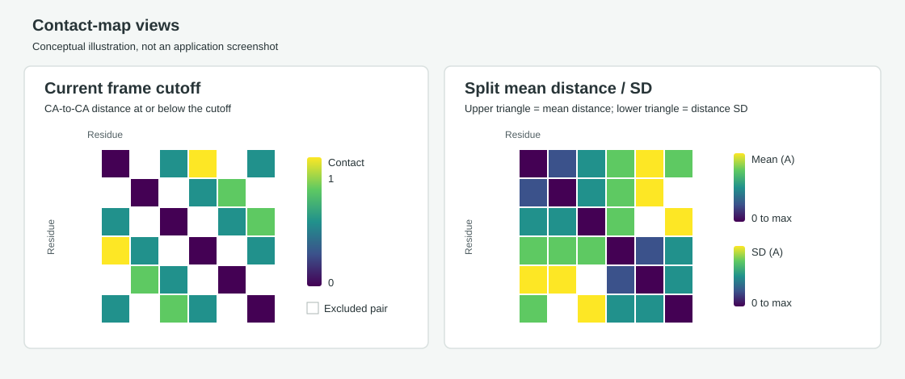

# PyMOL Contact Map Plugin

**Version 1.4.0**  
**Purpose:** inspect residue contacts and residue-pair distances for structures and trajectories loaded in PyMOL.

The plugin opens a separate window inside your PyMOL session. It reads the selected molecular object, updates as you change frames, and can save the displayed plot as an image. It does not alter the molecule's coordinates or write changes to your structure or trajectory files.



*Illustration only, not a screenshot. In the split view, mean distances occupy the upper triangle and distance standard deviations occupy the lower triangle.*

## What You Can Plot

Choose a view from the **Plot** menu in the plugin window:

| Plot option | What is displayed | Atoms and frames |
| --- | --- | --- |
| **Current frame cutoff** | Binary contact map: a pair is colored as a contact when its CA-to-CA distance is at or below the cutoff. | CA atoms in the current PyMOL frame. |
| **Current frame residue-center distances** | Pairwise Euclidean distances between residue geometric centers. Each center is the average position of that residue's non-hydrogen protein atoms. | Current PyMOL frame. |
| **Mean distance** | Mean CA-to-CA distance for each residue pair across the object's states. | All states/frames in the selected object. |
| **Distance standard deviation** | Population standard deviation of each CA-pair distance across the object's states. | All states/frames in the selected object. |
| **Mean + standard deviation** | Two maps side by side: mean CA-pair distance and its population standard deviation. | All states/frames in the selected object. |
| **Split mean / SD across diagonal** | Mean distance in the upper triangle; standard deviation in the lower triangle. The diagonal shows the zero mean self-distance. Each triangle has its own colorbar when **Auto max** is selected. | All states/frames in the selected object. |

The **mean distance** is not a residue-center distance or a closest-atom distance: it is the mean of CA-to-CA distances for each residue pair across frames. The **current frame residue-center distances** option is the one that uses geometric residue centers. The plugin does not currently calculate minimum atom-to-atom distances between residue surfaces.

## Install and Open

### Requirements

- PyMOL with its bundled Qt interface and NumPy. Matplotlib is not needed.
- A protein object loaded in the PyMOL session. The plugin does not load files itself.
- For trajectory analysis, one PyMOL object with multiple states. A multi-model PDB naturally loads as multiple states; a separate trajectory must be attached to a compatible topology.

### One-time use in a PyMOL session

1. Start PyMOL and open the structure or trajectory you want to analyze.
2. Locate PyMOL's command input area. These are **PyMOL commands**, not PowerShell commands.
3. Load the plugin by executing the following block. `runpy.run_path` is used because the Windows folder path contains spaces:

   ```pymol
   python
   import runpy
   runpy.run_path(r"C:\Users\yagd9\Documents\Stony Brook AI Drug Discovery\Github\Pymol-Public\contact map\__init__.py")
   python end
   ```

4. Open the window:

   ```pymol
   contact_map_gui
   ```

The window is called **Protein Contact Map**. Running `contact_map_gui` again raises the existing window if it is already open. The plugin also defines a **Contact Map** menu item when installed through a PyMOL plugin manager that supports this plugin format.

You need to load the plugin once per PyMOL session unless you install it permanently through your PyMOL build's Plugin Manager. Reopening PyMOL clears commands loaded with the one-time method.

### Load a protein and trajectory

For a separate topology and trajectory, first load the topology and then attach its matching trajectory to the same object:

```pymol
load "D:/data/protein.gro", protein
load_traj "D:/data/trajectory.xtc", protein
```

Use the actual paths to your files. Forward slashes are convenient in PyMOL commands on Windows; quote paths that contain spaces. Your PyMOL build must support the formats, and the topology and trajectory must have matching atom counts and ordering.

For an ensemble PDB that contains `MODEL`/`ENDMDL` records, load it as one object; each model becomes a state:

```pymol
load "D:/data/ensemble.pdb", ensemble
```

You can open the contact-map window before or after loading data. If you load an object after opening it, click **Refresh objects** to update the object list.

## First-use Walkthrough

Follow these steps once the data is loaded in PyMOL and the **Protein Contact Map** window is open.

1. **Select the object.** Open the **Object** dropdown and choose the protein or trajectory object. The object must contain protein CA atoms for cutoff and aggregate CA-distance plots. If the object is missing from the list, click **Refresh objects**.
2. **Check the frame count.** The label below the controls shows the current frame and total states for a current-frame plot. A single-state structure can show one frame; aggregate mean and SD then have only that one observation.
3. **Start with a current-frame view.** Choose **Current frame cutoff** to display a binary contact map for the frame PyMOL is currently showing. The status text reports the number of CA residues and contacts.
4. **Adjust the cutoff if desired.** The **Cutoff** control starts at `8.0 A`. Lowering it requires residues to be closer to count as a contact; raising it includes more distant pairs. This control is enabled only for the binary cutoff view.
5. **Choose the neighbor exclusion.** **Exclude same-chain neighbors** starts at `3`. Same-chain pairs within that many entries of each other in the selected residue order are omitted so local sequence neighbors do not dominate the map. Set it to `0` to include every off-diagonal pair. The diagonal is still treated as self-pairs in distance plots.
6. **Inspect residue-center distances if needed.** Choose **Current frame residue-center distances**. For each residue, the plugin averages the coordinates of its non-hydrogen protein atoms, then measures center-to-center distances for each residue pair in the current frame. The cutoff is disabled in this mode because it does not threshold distances.
7. **Move through the trajectory.** Drag PyMOL's frame slider or press Play. Current-frame plots refresh from the visible PyMOL frame about every 350 ms. Pause playback before saving if you want a specific frame image.
8. **Calculate a trajectory mean.** Choose **Mean distance** to display one mean CA-to-CA distance per residue pair, calculated over every state in the selected object. The status line reports the overall mean and overall population SD among eligible pairs.
9. **Inspect variability.** Choose **Distance standard deviation** to display the population SD of each pair's CA-to-CA distance across states. Higher values identify pairs whose separation varies more over the trajectory.
10. **Compare mean and variability side by side.** Choose **Mean + standard deviation** to place the two aggregate matrices next to one another. Each panel has its own legend.
11. **Compare both statistics in one matrix.** Choose **Split mean / SD across diagonal**. Read the upper triangle as mean distance and the lower triangle as distance SD. This is an optional compact presentation; use the side-by-side mode if you prefer two complete matrices.
12. **Choose Log or Linear coloring.** The square **Log** and **Linear** buttons control how numeric values map to viridis colors. Log is useful when many distances are small but a few are large. Linear allocates color evenly across the range.
13. **Choose the color maximum.** Leave **Auto max** checked to scale to the largest finite value. To compare plots using the same colors, uncheck **Auto max** and enter a fixed **Max (A)**. Values above the fixed maximum are clipped to the maximum color. In split mode, a fixed maximum is shared by the mean and SD panels; Auto max gives each triangle its own range.
14. **Save the image.** Click **Save plot…**, choose a destination and filename, then select PNG or JPEG. The saved image contains the currently displayed plot, labels, colorbars, and summaries. It is rendered at twice the window's on-screen pixel dimensions. Saving an image does not export the underlying numeric matrix as CSV.

The plugin does not change PyMOL coordinates, rotate the structure, or modify source files. Aggregate statistics are computed over all states of the selected object and cached for reuse. Choosing another object or changing the neighbor exclusion causes the aggregate values to be recalculated.

## How the Measurements Work

### Current-frame cutoff contacts

For CA coordinates $\mathbf{x}_i$ and $\mathbf{x}_j$, the contact is present when

$$
\lVert \mathbf{x}_i - \mathbf{x}_j \rVert_2 \leq c,
$$

where $c$ is the cutoff in Angstroms. The map is symmetric. Same-chain neighbors within the selected sequence-order exclusion and the diagonal are omitted.

### Current-frame residue-center distances

For each residue, the plugin averages the coordinates of its non-hydrogen protein atoms to get a geometric center:

$$
\mathbf{r}_i = \frac{1}{N_i}\sum_{a=1}^{N_i}\mathbf{x}_{ia}.
$$

The plotted value for a residue pair is $\lVert\mathbf{r}_i-\mathbf{r}_j\rVert_2$ in the current frame. This is a geometric center, not a mass-weighted center and not the closest distance between atoms.

### Mean and standard-deviation distances

For CA pair $i,j$ over $F$ object states, the mean distance is

$$
\bar d_{ij} = \frac{1}{F}\sum_{f=1}^{F} d_{ij}^{(f)}.
$$

The plugin displays the **population** standard deviation:

$$
\sigma_{ij} = \sqrt{\frac{1}{F}\sum_{f=1}^{F}\left(d_{ij}^{(f)}-\bar d_{ij}\right)^2}.
$$

The side summaries report the overall mean of the eligible pair distances and overall population SD, or summaries of per-pair SDs. Diagonal self-pairs and excluded same-chain neighbors are omitted from these summaries.

## Color Scales and Range

Both scale modes start at zero and map the selected maximum to the final viridis color. Values above a fixed maximum are clipped to that maximum.

- **Log** uses the zero-safe transform $\log(1+x)/\log(1+x_{\max})$. This expands color differences among small values while keeping zero valid.
- **Linear** uses $x/x_{\max}$, spreading colors evenly across the selected range.
- **Auto max** uses the maximum finite value in the plotted matrix. In split mode, each triangle gets its own automatic maximum.
- A fixed **Max (A)** applies to both halves of the split plot, which makes them directly comparable. A residue-center/CA distance above that value uses the maximum color.
- In the binary cutoff-contact view, the color range is fixed at 0 to 1; the distance max field is disabled.

White cells indicate omitted pairs (diagonal or excluded same-chain neighbors). For distance matrices, a genuine zero value is colored with the first viridis color rather than white.

## Controls at a Glance

| Control | Default | Applies to |
| --- | --- | --- |
| Object | First available molecular object | All views |
| Cutoff | `8.0 A` | Current frame cutoff only |
| Exclude same-chain neighbors | `3` sequence-order entries | All views |
| Plot | Current frame cutoff | All views |
| Color scale | Log | All views |
| Auto max | On | Distance plots; cutoff contacts always use 0-1 |
| Max (A) | `40.00` when enabled | Distance plots with Auto max off |

## Requirements and Limitations

- PyMOL with its bundled Qt interface and NumPy. Matplotlib is not required.
- Contact and aggregate CA-distance views require protein CA atoms in the selected object.
- Residue-center distance view requires at least one residue pair to remain after same-chain neighbor exclusions; each included residue needs non-hydrogen protein atoms.
- Aggregate views require matching CA residue labels across all states; the plugin reports an error if the selected residue set changes between frames.
- The plugin analyzes coordinates already loaded into PyMOL. It does not align, transform, or modify those coordinates.
- Large trajectories can take time to calculate the first aggregate map. Progress is shown in the status line; subsequent requests with the same object and neighbor setting use cached statistics.
- An empty map can result when the object has no protein residues, or when the same-chain neighbor exclusion removes every eligible pair.

## Version History

| Version | Incremental changes |
| --- | --- |
| **1.0.0** | Initial live CA contact map with object selection, distance cutoff, same-chain neighbor exclusion, frame refresh, and a separate PyMOL Qt window. |
| **1.1.0** | Added plot saving, viridis coloring, and aggregate plot controls. The first aggregate implementation used contact occupancy; this was replaced in 1.2.0. |
| **1.2.0** | Corrected aggregate plots to mean CA-pair distance and distance SD; added the optional split-diagonal view and zero-based logarithmic color mapping. |
| **1.3.0** | Added square Log/Linear controls, Auto max, and a user-set maximum range with clipping. |
| **1.4.0** | Separated the current-frame cutoff contact map from a new current-frame residue-center distance map based on geometric centers of non-hydrogen protein atoms. |

## Troubleshooting

**The object menu is empty.** Load a molecular object in PyMOL and press **Refresh objects**.

**The plot says no protein CA atoms were found.** This view requires protein residues with CA atoms. Check the selected object and loaded state.

**The residue-center view has too few pairs.** Reduce **Exclude same-chain neighbors** or select an object with more protein residues. The view needs at least one eligible residue pair.

**A color looks saturated.** Increase **Max (A)** or turn **Auto max** back on. Values over a fixed maximum are intentionally clipped.

**The plot does not change while playing.** Confirm the object has multiple PyMOL states and that the global frame slider is moving. Current-frame views refresh from PyMOL's current frame.

**The plugin command is not found.** Load the plugin file first in the PyMOL session, then run `contact_map_gui`.